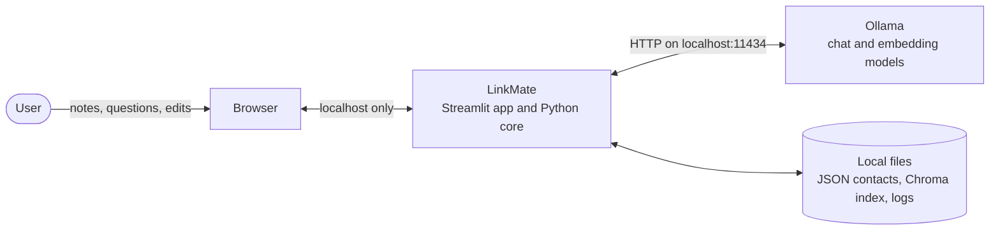
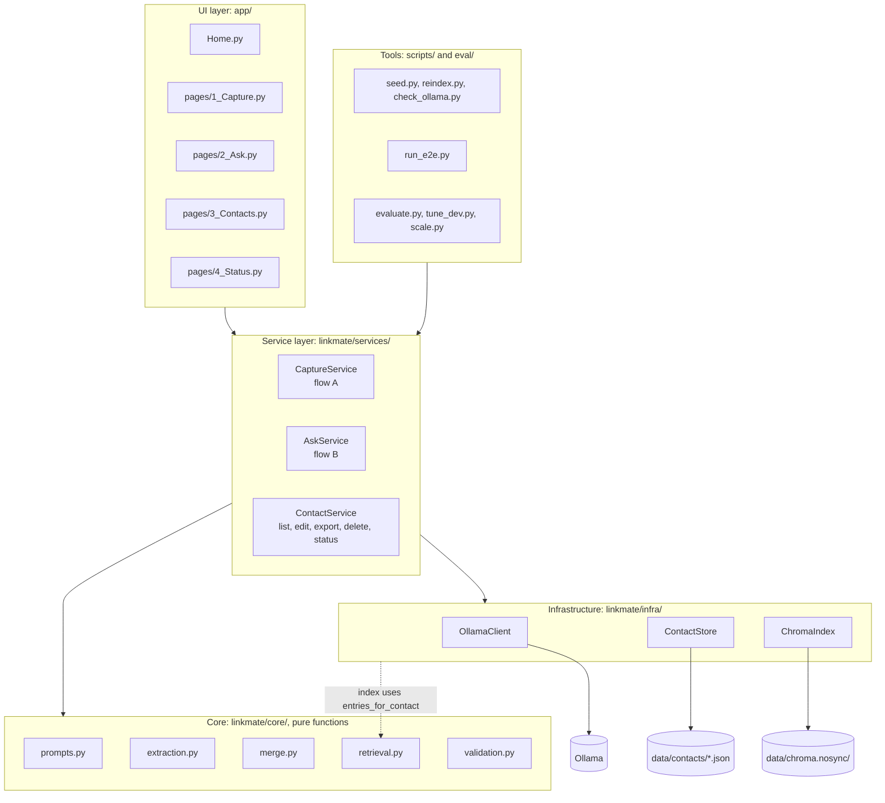
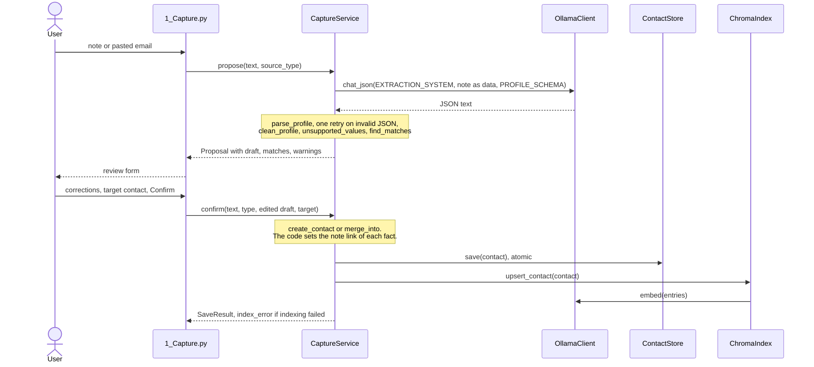
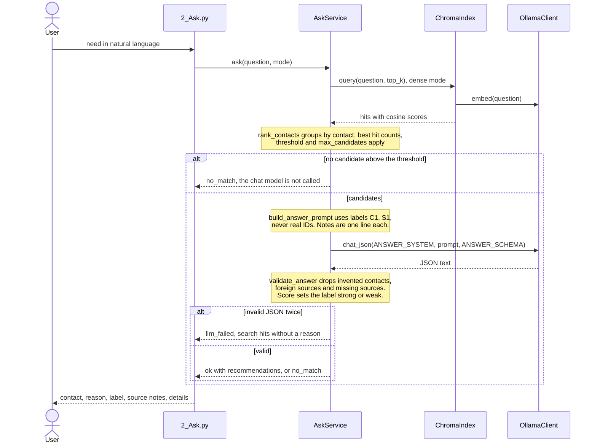
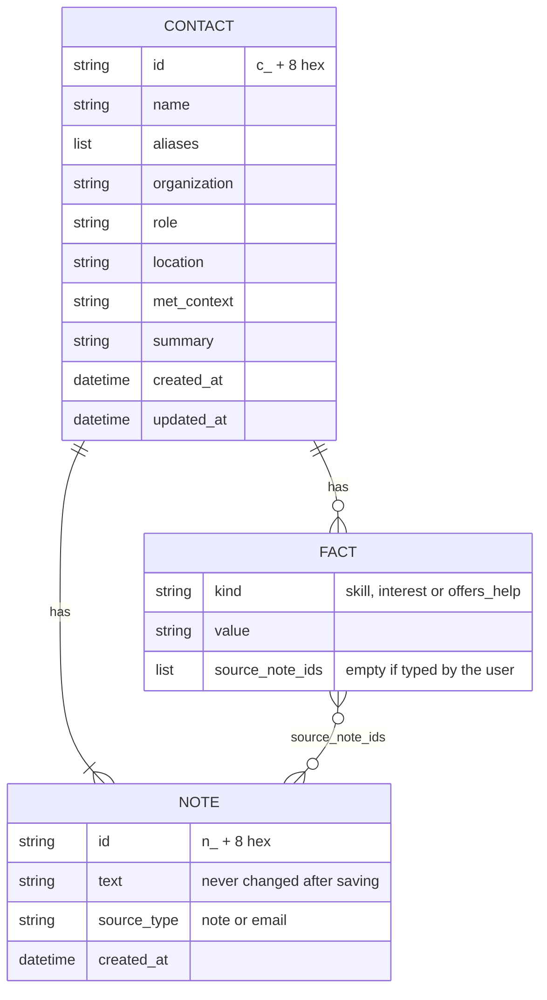
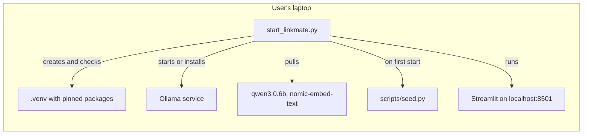

# LinkMate architecture

This document describes the system as it is implemented, derived from the code in this repository. Every statement can be checked in the files named next to it. Planned work is marked as planned and listed in section 11.

## 1. Purpose and context

LinkMate is a personal network manager for individuals. Free-text notes about people become reviewed contact profiles. A question in natural language returns up to three contacts, each with a reason and the source notes, or the answer "no suitable contact". Everything runs on one laptop. No note leaves the machine.

## 2. Architecture overview

The code has four layers. Dependencies point downward only. The UI and the scripts call services and never touch the store, the index or Ollama directly.

`linkmate/models.py` holds the data model and `linkmate/config.py` loads `config.yaml`. All layers use both. `build_services` in `linkmate/services/__init__.py` is the composition root: it creates the client, the store and the index once and passes them to the services. Unit tests use the same seam to pass a fake LLM and embedder.

## 3. Components

| Component | File | Responsibility | Depends on |
|---|---|---|---|
| Pages | `app/pages/*.py`, `app/Home.py` | Forms and display, session state, friendly errors | services |
| Shared UI | `app/common.py` | Cached services, profile form, Markdown escaping, shutdown | services |
| `CaptureService` | `linkmate/services/capture.py` | Note to proposal, proposal to saved contact. `confirm` is the only write path of flow A | client, store, index |
| `AskService` | `linkmate/services/ask.py` | Question to validated recommendations with a confidence label | client, store, index |
| `ContactService` | `linkmate/services/contacts.py` | List, edit, export, delete, rebuild, status | client, store, index |
| Prompts and schemas | `linkmate/core/prompts.py` | System prompts, JSON schemas, labels C1 and S1, note excerpts | models |
| Extraction cleanup | `linkmate/core/extraction.py` | Drops placeholders and duplicates, flags values the note does not contain | models |
| Merge | `linkmate/core/merge.py` | Name matching, deterministic merge, user edits, provenance | models |
| Retrieval | `linkmate/core/retrieval.py` | Profile text, chunking, BM25, ranking per contact, hybrid fusion | models |
| Sanitizing | `linkmate/core/sanitize.py` | Detects and removes instruction-like sentences from what the models see | none |
| Validation | `linkmate/core/validation.py` | Parses LLM output, resolves labels, drops anything unsupported | prompts, models |
| `OllamaClient` | `linkmate/infra/ollama_client.py` | HTTP calls, error types, batching, LLM call log | requests |
| `ContactStore` | `linkmate/infra/store.py` | One JSON file per contact, atomic writes, corrupt file detection | models |
| `ChromaIndex` | `linkmate/infra/index.py` | Embeds entries, cosine search, rebuild and self repair | chromadb, retrieval |
| Start script | `start_linkmate.py` | Checks and installs prerequisites, starts and stops the app, builds the zip | standard library only |

## 4. Data flows

### Flow A: capture

The LLM only proposes. Nothing is written until the user confirms in the review form.

### Flow B: ask

### Flow C: maintenance

Editing a profile, deleting a note and deleting a contact write the JSON first and then update the index (`linkmate/services/contacts.py`). If the index update fails, the JSON stays saved, the UI shows a warning, and the Status page offers a rebuild. The index is derived data and `rebuild` recreates it from the store at any time.

## 5. Data model

The source of truth is one JSON file per contact in `data/contacts/`, written through a temporary file and `os.replace`, so a crash cannot leave half a file. The search index stores derived entries in one Chroma collection with cosine distance:

| Entry | ID | Text | Metadata |
|---|---|---|---|
| Profile | `<contact id>:profile` | Rendered from all profile fields (`profile_text`) | `contact_id`, `doc_type=profile` |
| Note chunk | `<note id>:<number>` | Note text, split at sentence ends above 500 characters (`chunk_text`) | `contact_id`, `note_id`, `doc_type=note` |

Merge rules (`linkmate/core/merge.py`) are deterministic. A note always adds to a contact. Lists are combined without duplicates, the summary grows, and earlier notes stay attached. The review form starts from everything already known (`additive_draft`) and lists only new facts, so a fact is linked only to the note that states it. If a note suggests another organization, role or location, the current value stays unless the user changes it in the form, and the confirmed value then replaces the old one. Where someone was first met is only set once. A new name becomes an alias.

## 6. Interfaces

### Service API, the boundary used by the UI and all scripts

| Call | Input | Output | Side effects |
|---|---|---|---|
| `capture.propose(note_text, source_type)` | Non-empty text | `Proposal` (draft, matches, warnings, `extraction_failed`) | LLM call and log, no data written |
| `capture.confirm(note_text, source_type, draft, contact_id, created_at)` | Reviewed draft, optional target | `SaveResult` (contact, changes, `index_error`) | Writes JSON, updates index |
| `ask.search(question, mode)` | Question, `dense`, `bm25` or `hybrid` | `list[Candidate]` | None, no chat model |
| `ask.ask(question, mode)` | Non-empty question | `AskResult` with `status` `ok`, `no_match` or `llm_failed` | LLM call and log |
| `contacts.update_contact(id, draft)` | Edited profile | Error text or empty | Writes JSON, updates index |
| `contacts.export_json()` | None | JSON text with all contacts and notes | None |
| `contacts.delete_contact(id)`, `delete_note(id, note_id)` | IDs | Error text or empty | Writes JSON, updates index |
| `contacts.rebuild_index()` | None | None | Replaces the index |
| `contacts.status()` | None | `SystemStatus` | None |

`OllamaUnavailable` and `ModelMissing` reach the UI, which shows the fix. Other Ollama errors and invalid JSON during an answer become `llm_failed`, and the user still sees the search hits with their notes.

### Ollama HTTP API, used by `OllamaClient`

| Endpoint | Use | Body |
|---|---|---|
| `POST /api/chat` | Extraction and answers | `model`, `messages`, `format` (JSON schema), `think: false`, `options` (`temperature: 0`, `num_ctx: 4096`), `stream: false` |
| `POST /api/embed` | Entries and questions, 64 texts per request | `model`, `input` with prefix `search_document:` or `search_query:` |
| `GET /api/tags` | Checks that models are installed | None |

Prompts, schemas, input and output are documented in [`llm_workflow.md`](llm_workflow.md).

### Configuration

`config.yaml` holds all settings. `LINKMATE_OLLAMA_HOST` and `LINKMATE_DATA_DIR` override the host and the data folder. The project uses no API keys and no credentials.

| Setting | Value | Meaning |
|---|---|---|
| `llm.model` | `qwen3:0.6b` | Chat model for extraction and answers |
| `embedding.model` | `nomic-embed-text` | Embedding model |
| `retrieval.mode` | `dense` | `dense`, `bm25` or `hybrid` |
| `retrieval.top_k` | 20 | Index entries fetched per question |
| `retrieval.threshold` | 0.59 | Minimum cosine score of a contact's best entry |
| `retrieval.max_candidates` | 5 | Contacts shown to the LLM |
| `answer.max_recommendations` | 3 | Upper limit per answer |
| `answer.notes_per_contact` | 3 | Notes per candidate in the prompt |
| `answer.max_note_chars` | 600 | Note length in the prompt |
| `answer.strong_from` | 0.67 | Score from which a recommendation is labeled strong, in dense mode only |

## 7. Design decisions

| # | Decision | Reason | Alternative considered | Evidence or consequence |
|---|---|---|---|---|
| D1 | Local models through Ollama | Notes hold third-party data. No usage cost | Hosted LLM API | Runs on an 8 GB laptop, no network needed after setup |
| D2 | `qwen3:0.6b` as chat model | Smallest model that passed the tests, 0.5 GB on disk | `qwen3:1.7b` | The larger model did worse in the same pipeline, see `reports/` |
| D3 | JSON files as source of truth, Chroma as derived index | Inspectable, easy to delete and export, index can be rebuilt | Database as the only store | `run_e2e.py` deletes the index and rebuilds it with identical results |
| D4 | The LLM proposes, the user confirms | A wrong extraction must not enter the network silently | Automatic saving | Only `confirm` writes in flow A, tested in `tests/test_flows.py` |
| D5 | The LLM never sees IDs, it answers with labels | Forged IDs cannot resolve to anything. Code maps labels back | Real IDs in the prompt | `validate_answer` drops everything that does not resolve |
| D6 | The code sets provenance, not the LLM | Citations cannot be invented when the code sets them | LLM reports sources for facts | `add_fact` in `merge.py` |
| D7 | A contact counts with its best hit | Long or many notes must not win by volume | Sum or mean of hits | Measured in the note length check of `eval/evaluate.py` |
| D8 | Search threshold before the LLM | No LLM call and no invented match when nothing is close | Always call the LLM | Saves time, catches clearly unrelated questions |
| D9 | Confidence label instead of a second LLM pass | Near misses pass the threshold and the small model accepts them. Two LLM-based fixes made it worse | Strict prompt, verification pass | `reports/tuning_dev.md` has the numbers |
| D10 | Dense search as default, BM25 and hybrid selectable | Dense finds paraphrased needs. Keyword search is kept as baseline | Hybrid as default | `reports/evaluation/` compares all three |
| D11 | Sentence chunks for long notes | An offer late in a pasted email stayed invisible to the prompt | Whole-note embeddings | Question t08 and t17 target this case |
| D12 | Notes are marked as data and flattened, instruction-like sentences are removed | A note must not be able to fake labels, close its own block or steer the model. An email did influence answers before this guard | Trust the system prompt alone | `eval/injection_counterfactual.py`, `eval/injection_cases.py` |
| D13 | Keep Streamlit for the prototype | One language, fast iteration | Separate web frontend | Single user only, see section 9 |

## 8. Safety and privacy

| Rule | Where it is enforced |
|---|---|
| The LLM never writes data and has no tools | `CaptureService.propose` returns a proposal, `confirm` saves |
| No answer without a valid source | `core/validation.py`, rechecked independently in `eval/evaluate.py` |
| Prompt injection | `core/sanitize.py` removes instruction-like sentences before embedding and LLM calls and warns in the review, `extraction_user_prompt` removes note tags, `_one_line` flattens notes and profile fields, the output is schema-bound, labels only. A keyword rule can be beaten, so the review is the final control |
| No remote content from notes | `safe_md` escapes Markdown, so a pasted email cannot load a remote image |
| Nothing leaves the laptop, as long as `LINKMATE_OLLAMA_HOST` stays local | `start_linkmate.py` and `.streamlit/config.toml` bind the server to localhost, Chroma and Streamlit telemetry are off, `embedding_function=None` prevents a model download |
| User control over data | Edit, export, delete of contacts and notes. The LLM log keeps note texts after a delete until it is deleted on the Status page, which says so |
| Secrets | None exist. `.gitignore` excludes runtime data, only synthetic data is committed |

## 9. Deployment and operations

The prototype serves one user on one machine. `@st.cache_resource` in `app/common.py` keeps one set of services per server process. `data/logs/llm_calls.jsonl` records every prompt, output and duration, and the Status page shows the call count and the average time. Measured resource use and scale limits are in `reports/evaluation/`.

## 10. Failure behavior

| Failure | Behavior | Test |
|---|---|---|
| Ollama is down | Status banner, capture and ask disabled, clear error if it stops mid-way | `run_e2e.py` Ollama failures |
| Model missing | Banner with the exact `ollama pull` command | `tests/test_ui.py` |
| Invalid JSON from the LLM | One retry. Extraction then opens an empty form, answers fall back to search hits | `tests/test_flows.py` |
| Indexing fails after save | JSON stays, warning shown, Status page reports out of sync, rebuild recovers | `tests/test_flows.py`, `run_e2e.py` |
| Corrupt contact file | Skipped and listed on the Status page | `tests/test_flows.py` |
| Damaged or deleted index | Starts empty, rebuild repairs it | `tests/test_flows.py`, `run_e2e.py` |

## 11. Implemented and planned

| Status | Item |
|---|---|
| Implemented | Capture with review, add notes to a contact, ask with reason and sources, confidence label, three search modes, contact list with edit, export and delete, status page, one-command start, evaluation suite |
| Implemented, untested on the platform | Windows and Linux start paths, automatic Ollama installation |
| Planned | Photo and voice input, email and LinkedIn import, mobile-optimized interface, cloud sync for the premium tier |
| Known limits | See "Known limitations" in the [README](../README.md) |
