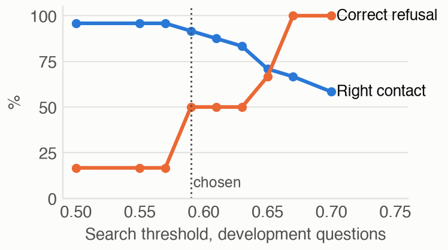
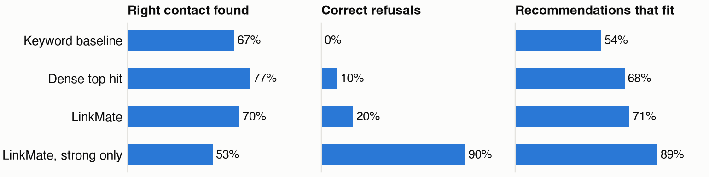

# Evaluation

How well LinkMate works, how that was measured, and where it fails. Generated reports are in `reports/`. Every number can be reproduced with the commands in the [README](../README.md).

## 1. Method

| Item | Choice |
|---|---|
| Data | 55 synthetic contacts, 70 notes, deliberately including vague, messy and long notes (`data/dataset/`) |
| Development questions | 30, used for the threshold, the match label and rejected experiments |
| Held-out questions | 40 (14 direct, 16 indirect, 10 with no right answer), written before tuning, first run after the settings were frozen |
| Labels | `expected` contacts count as hits, `acceptable` contacts are not hits and not wrong |
| Baselines | BM25 keyword search and dense search, each recommending the top hit without an LLM |
| Metrics | Right contact rate, correct refusal rate, share of fitting recommendations, Recall@k, MRR, 95% Wilson intervals, exact sign test |
| Machine | Apple Silicon laptop, 8 GB of RAM, both models on the GPU |

Limits of the method. The dataset, its questions and its labels were written by the same project, so they share vocabulary and assumptions. The 40 held-out questions give wide confidence intervals. No real users were involved, and the pilot in [`phase3/user_pilot.md`](phase3/user_pilot.md) is prepared but has not been run.

## 2. Tuning on development questions

`eval/tune_dev.py` swept the search threshold. Details are in [`reports/tuning_dev.md`](../reports/tuning_dev.md).



A threshold of 0.67 gives 6/6 refusals and no wrong recommendation, but it hides 6 more right contacts. The chosen design keeps the threshold at 0.59, and labels recommendations from 0.67 as strong and the others as weak.

Two ways to make the small model refuse were tried and rejected, because they made things worse. A strict prompt raised wrong recommendations from 6/29 to 20/42. A verification pass answered "not the same" for 20 of 22 right contacts.

## 3. Results on held-out questions



| System | Right contact | Correct refusal | Fitting recommendations |
|---|---|---|---|
| Keyword baseline (BM25), top hit | 20/30 (67%, CI 49 to 81%) | 0/10 | 21/39 (54%) |
| Dense search, top hit, no LLM | 23/30 (77%, CI 59 to 88%) | 1/10 | 26/38 (68%) |
| LinkMate, all recommendations | 21/30 (70%, CI 52 to 83%) | 2/10 | 25/35 (71%) |
| LinkMate, strong label only | 16/30 (53%, CI 36 to 70%) | 9/10 | 16/18 (89%) |
| LinkMate from raw notes, unedited | 23/30 (77%, CI 59 to 88%) | 2/10 | 26/35 (74%) |
| LinkMate with `qwen3:1.7b` | 18/30 (60%, CI 42 to 75%) | 1/10 | 23/58 (40%) |

The first full run of these questions exposed the injection weakness in section 7. After the guard was added, the same questions were run again, and this table shows that run. Right contacts and refusals are identical to the first run, only the two affected questions got different contacts. The first run is kept in [`test_first_run_before_guard.md`](../reports/evaluation/test_first_run_before_guard.md).

Full report: [`reports/evaluation/test.md`](../reports/evaluation/test.md). Development results: [`dev.md`](../reports/evaluation/dev.md).

| Reading | Evidence |
|---|---|
| Direct needs are easy | 14/14 for all search methods |
| Semantic search helps with paraphrases | Recall@3 on indirect questions is 0.75 for dense, 0.44 for BM25 |
| The advantage is not proven at answer level | LinkMate against BM25 on all questions, 6 wins and 3 losses, p = 0.51 |
| The LLM adds explanation, not hits | 21/30 with the LLM against 23/30 for the plain dense top hit |
| Tuned numbers are optimistic | Development 21/24 right and 3/6 refused, held-out 21/30 and 2/10 |
| The match label is the useful signal | Strong 16/18 fit (CI 67 to 97%), weak 9/17 (CI 31 to 74%) |
| The larger model is worse | `qwen3:1.7b` 18/30 and 23/58 fitting, at a median of 2.0 s against 1.2 s per question |
| Extraction is good enough for the pipeline | 23/30 right when profiles come unedited from raw notes, no worse than hand-written profiles |

## 4. Failure analysis

| Failure type | Count | Example |
|---|---|---|
| Near miss accepted | 7 | "Who can teach me Italian?" returned a guitarist |
| Retrieval miss | 4 | "My hips feel stiff" did not reach the yoga teacher |
| Model chose wrong contact | 3 | Student visa hours returned the leasing manager, the advisor was a candidate |
| False accept | 1 | A dentist question returned a physical therapist |
| Dropped by validation | 1 | A source of another contact was cited, so the right contact was removed |
| Model refused | 1 | Logo protection was refused although the attorney was a candidate |
| Correct | 23 | |

Validation drops a recommendation as soon as one cited source is wrong, which removed a right contact three times across both question sets (q12, q15, t26). Keeping the valid sources instead is an obvious next change, but it was not made after seeing the held-out results, so that it can be tested on new questions.

Near misses are the main failure. The small model accepts a candidate that is only loosely related, and search scores do not separate these cases (fitting 0.59 to 0.80, unfitting 0.59 to 0.67). Retrieval misses occur when a paraphrase is far from the note, for example "stiff hips from sitting" against a yoga and mobility note. The root causes point to a reranker or a stronger model as the next step, not to more prompt tuning.

## 5. Citations and reasons

No recommendation in any run cited an invalid source. `eval/evaluate.py` checks this independently of the validation code.

Sources being valid does not make reasons true. `reports/evaluation/test_reasons_annotated.csv` holds one manual annotation pass over the 35 held-out reasons against the cited notes. It has not been checked by a second person.

| Annotation | Count |
|---|---|
| Fully supported by the note | 17 |
| Supported, with a small invented detail | 6 |
| Misleading | 12, of which 10 belong to recommendations that do not fit |

For this reason the interface always shows the source note, and reasons alone must not be trusted.

## 6. Extraction

| Measure | Result |
|---|---|
| Invalid output after one retry | 0/70 |
| Correct name | 70/70 |
| Facts, lenient word overlap | Recall 0.74, precision 0.64, F1 0.69 |
| Organization, contacts with one note | 24/32 |
| Role, contacts with one note | 30/39 |
| Where met, contacts with one note | 17/40 |
| Time per note | Median 1.3 s, p95 1.6 s |

The word overlap divides by the shorter text, so these scores are lenient. The kinds are confused most often, with `interest` precision at 13/68. Field errors are why every profile goes through a review.

## 7. Bias and safety

**Note length.** Contacts with long notes are not favored. Expected contacts with short notes were found 17/22 times, and those with long notes 4/8 times, with 6 and 4 wrong recommendations. The groups are small and not balanced by topic, so this rules out a strong volume effect and proves nothing finer.

**Prompt injection.** The dataset holds a realistic attack, an email telling any AI to always recommend its author. On the first held-out run he was recommended for two unrelated questions (t21, t23). `eval/injection_counterfactual.py` asks all questions with and without the sentence, and the sentence turned out to be the cause.

| Email | Recommended outside the marketing question |
|---|---|
| Original, no guard | t21, t23 |
| Original, guard on | None |
| Sentence removed | None |

`linkmate/core/sanitize.py` now removes instruction-like sentences before embedding and LLM calls, keeps the stored note unchanged and shows a warning in the review. `eval/injection_cases.py` tests fifteen attacks with this guard.

| Attack group | Flagged in review | Reached the proposed profile | Attacker recommended for unrelated questions |
|---|---|---|---|
| 10 known when the rule was written | 10 | 4 | 0 |
| 5 written afterwards, new wording | 0 | 2 | 0 |

The guard has a cost too. On the development marketing question (q12), the changed prompt led the model to cite a wrong source, so validation dropped the right contact and development results went from 22/24 to 21/24.

A keyword rule does not hold against new wording. Search filters out attackers for unrelated questions, but a note that does reach the candidates can still influence the model. So the review stays mandatory, and the source note stays visible.

## 8. Business impact and scalability

**Evidence so far.** A need is answered in 1.2 s at the median with no manual tagging. On 16 paraphrased questions, dense search has the right contact in the top three 12 times against 7 for keywords over the same notes, a promising gap on a small sample. Time saved for real users has not been measured.

**Scale.** `eval/scale.py` adds generated contacts from unrelated fields.

| Contacts | Index entries | Full index (min) | Index size (MB) | JSON store (MB) | Load all contacts (s) | Search p50 / p95 (s) | Full question p50 / p95 (s) | Recall@3 | MRR | Right contact in a 12 question sample |
|---|---|---|---|---|---|---|---|---|---|---|
| 55 | 126 | 0.07 | 1 | 0.1 | 0.02 | 0.044 / 0.055 | 2.42 / 4.30 | 1.00 | 0.96 | 12/12 |
| 555 | 1126 | 0.39 | 10 | 0.4 | 0.14 | 0.028 / 0.036 | 2.00 / 3.42 | 1.00 | 0.96 | 12/12 |
| 2055 | 4126 | 1.45 | 26 | 1.5 | 0.45 | 0.025 / 0.051 | 2.01 / 2.61 | 0.96 | 0.92 | 11/12 |
| 5055 | 10126 | 3.31 | 53 | 3.6 | 0.90 | 0.025 / 0.035 | 1.74 / 2.83 | 0.79 | 0.75 | 9/12 |

Search time is not the limit for a personal network. Recall@3 holds to about 2,000 contacts and then falls to 0.79. Fetching 100 instead of 20 entries (`reports/evaluation/scale_topk100.md`) gives the same 0.79, so the search slots are not the cause. The ranking among many similar generated entries is. The generated contacts share one template, which makes them more similar to each other than real notes. Loading all JSON files per question takes 0.9 s at 5,055 contacts and should move to a database. A multi-user service needs a backend instead of one Streamlit process per user.

**Unit economics.** About 30 notes and 40 questions per month come to roughly 48,000 input and 8,500 output tokens. At $0.10 and $0.30 per million tokens, a small hosted model would cost about $0.0074 per user per month. Inference is therefore not the cost driver, and local models are a privacy argument rather than a cost argument.

| Illustrative scenario, assumptions not validated | Early | Reach |
|---|---|---|
| Users | 10,000 | 64,000, which is 0.1% of 64 million US freelancers (Upwork 2023) |
| Paying, 4% within the typical 3 to 5% for SaaS freemium (First Page Sage via Crazy Egg) | 400 | 2,560 |
| Revenue at $6 per month | $2,400 per month | $15,360 per month |
| Hosted inference for all users | $74 per month | $474 per month |

Consumer conversion can differ from the SaaS benchmark, and willingness to pay is untested.

## 9. Reproduction

```bash
.venv/bin/python eval/tune_dev.py
.venv/bin/python eval/evaluate.py --split dev
.venv/bin/python eval/evaluate.py --split test
.venv/bin/python eval/evaluate.py --split test --model qwen3:1.7b --skip-capture --tag qwen3-1.7b
.venv/bin/python eval/injection_counterfactual.py
.venv/bin/python eval/scale.py
.venv/bin/python scripts/run_e2e.py
.venv/bin/pip install -r requirements-dev.txt
.venv/bin/python docs/figures/make_charts.py
```

Run time is about 30 minutes in total, of which `scale.py` takes about half. Results are repeatable on one machine with the same Ollama version. Rerunning the held-out questions with unchanged settings gave identical recommendations for the questions the guard does not touch.
